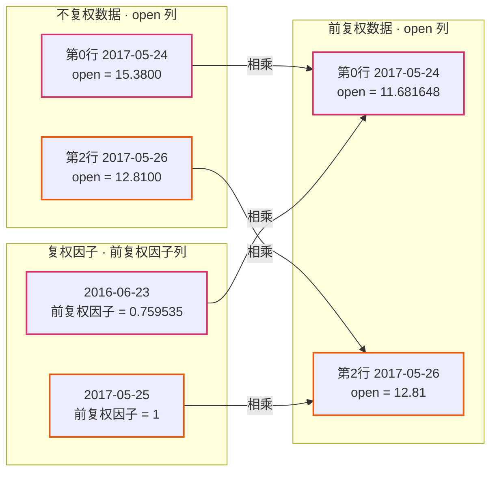
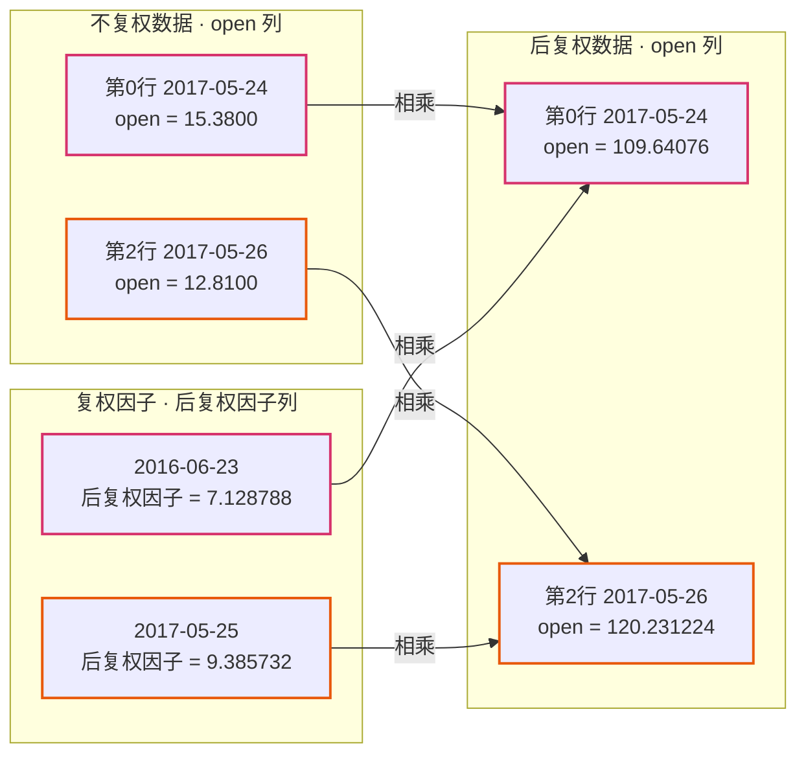

# BaoStock 复权因子简介

**复权因子**有多种算法，BaoStock 使用的是**涨跌幅复权算法**。

**涨跌幅复权法**不是以参加分配的实际收益作为计算前提的，因此无法计算出投资者参加分配的收益。涨跌幅复权法可以计算出原始资金的收益率，假设投资者在除权日前一天卖出全部的股票，然后在除权日用全部资金以昨收盘价买回，即不参加分配。这样的假设基于如下目的，确保初始投入的资金100%得到使用，既不会因为分红而导致投资减少，也不会因为配股而导致投资增加。

根据涨跌幅复权法，复权因子计算方法如下：

**后复权因子** = 前一天的收盘价/当天的前收，上市首日后复权因子为1。

**前复权因子** = 当天的前收/前一天的收盘价，最近一次除权除息日后的交易日前复权因子为1。

## 一、名词解释

**除权除息日**：除权除息日即股权登记日下一个交易日。在股票的除权除息日，证券交易所都要计算出股票的除权除息价，以作为股民在除权除息日开盘的参考。其意义是股票股利分配给股东的日期。

**前复权**：以当前股价为基准向前复权计算股价。

**后复权**：以上市首日股价作为基准向后复权计算股价。

**复权因子**：复权因子就是权息修复比例。

**向前复权因子**：以最近一次复权为例，除权除息日复权因子是1，前复权价格和不复权价格一致；股权登记日复权因子小于1，前复权价格是不复权价格乘以当日的前复权因子。

**向后复权因子**：以最近一次复权为例，除权除息日复权因子和前一交易日不同，后复权价格是不复权价格乘以新的后复权因子；股权登记日复权因子和前一交易日相同，后复权价格是不复权价格乘以旧复权因子。

## 二、利用复权因子计算复权价格

以浦发银行为例：

| 股票代码 | 复权日期 | 前复权因子 | 后复权因子 |
|---|---|---|---|
| sh.600000 | 2016-06-23 | 0.759535 | 7.128788 |
| sh.600000 | 2017-05-25 | 1 | 9.385732 |

### 不复权：

| | date | code | open | close | preclose |
|---|---|---|---|---|---|
| 0 | 2017-05-24 | sh.600000 | 15.3800 | 15.4700 | 15.4300 |
| 1 | 2017-05-25 | sh.600000 | 11.7500 | 12.9300 | 11.7500 |
| 2 | 2017-05-26 | sh.600000 | 12.8100 | 12.8400 | 12.9300 |

### 前复权

| | date | code | open | close | preclose |
|---|---|---|---|---|---|
| 0 | 2017-05-24 | sh.600000 | 11.681648 | 11.750007 | 11.719625 |
| 1 | 2017-05-25 | sh.600000 | 11.75 | 12.93 | 11.75 |
| 2 | 2017-05-26 | sh.600000 | 12.81 | 12.84 | 12.93 |

**计算方法：**

不复权，第0行，日期为2017-05-24，开盘价15.38，查找小于等于此日期（早于这个日期）的**前复权因子**（即2016-06-23的前复权因子）为0.759535，则前复权开盘价为：15.38 * 0.759535 = 11.681648；同样的收盘价、昨日收盘价也使用此计算。

不复权，第1、2行，日期分别为2017-05-25、2017-05-26，查找小于等于此日期的前复权因子（即2017-05-25的复权因子）为1，则：前复权开盘价 = 不复权开盘价 * 1。

**前复权计算示例**（PDF 第 2 页示意图的文字转录）：

示意图由三个带框表格与四条箭头构成，箭头含义为「相乘得到」。三个框内的表格数据与上文完全相同（「不复权数据」= 上文不复权表，「复权因子」= 上文复权因子表，「前复权数据」= 本节前复权表），图中额外框出并连线的是以下两组计算：

- **第 0 行（红色箭头）**：不复权数据第 0 行（2017-05-24）的 open **15.3800**，与复权因子表中 2016-06-23 的前复权因子 **0.759535**，两者相乘指向前复权数据第 0 行的 open **11.681648**（15.3800 × 0.759535 = 11.681648）。
- **第 2 行（橙色箭头）**：不复权数据第 2 行（2017-05-26）的 open **12.8100**，与复权因子表中 2017-05-25 的前复权因子 **1**，两者相乘指向前复权数据第 2 行的 open **12.81**（12.8100 × 1 = 12.81）。

第 1 行（2017-05-25）未画箭头：其前复权因子为 1，前复权价格与不复权价格相同。

### 后复权

| | date | code | open | close | preclose |
|---|---|---|---|---|---|
| 0 | 2017-05-24 | sh.600000 | 109.64076 | 110.28235 | 109.9972 |
| 1 | 2017-05-25 | sh.600000 | 110.28235 | 121.35751 | 110.28235 |
| 2 | 2017-05-26 | sh.600000 | 120.231224 | 120.512794 | 121.35751 |

**计算规则：**

不复权，第0行，日期为2017-05-24，开盘价15.38，查找小于等于此日期（早于这个日期）的**后复权因子**（即2016-06-23的后复权因子）为7.128788，则前复权开盘价为：15.38 * 7.128788 = 109.64076；同样的收盘价、昨日收盘价也使用此计算。

不复权，第1、2行，日期分别为2017-05-25、2017-05-26，查找小于等于此日期的前复权因子（即2017-05-25的后复权因子）为9.385732，则：前复权开盘价 = 不复权开盘价 * 9.385732。

**后复权计算示例**（PDF 第 3 页示意图的文字转录）：

示意图结构与上图相同：三个带框表格（「不复权数据」= 上文不复权表，「复权因子」= 上文复权因子表，「后复权数据」= 本节后复权表）与四条「相乘得到」箭头，额外框出并连线的是以下两组计算：

- **第 0 行（红色箭头）**：不复权数据第 0 行（2017-05-24）的 open **15.3800**，与复权因子表中 2016-06-23 的后复权因子 **7.128788**，两者相乘指向后复权数据第 0 行的 open **109.64076**（15.3800 × 7.128788 = 109.64076）。
- **第 2 行（橙色箭头）**：不复权数据第 2 行（2017-05-26）的 open **12.8100**，与复权因子表中 2017-05-25 的后复权因子 **9.385732**，两者相乘指向后复权数据第 2 行的 open **120.231224**（12.8100 × 9.385732 = 120.231224）。

第 1 行（2017-05-25）未画箭头：其后复权 open 110.28235 = 不复权 open 11.7500 × 9.385732，规则与第 2 行相同。

## 三、关于复权的常见问题

### 1. 前后复权对收益的影响

如果股票有过配股增发，存在追加投资金额的情况，会使得使用前复权和后复权计算出来的收益率和实际收益率可能不同。

### 2. 前复权和后复权那哪种方式好

各有优劣，如果是分析短周期数据，前后复权差别并不大；如果分析最近一段时间的数据，用前复权比较合适；如果是分析很长一段时间的数据，尤其是分析上市公司上市以来的所有数据，使用后复权比较合适。

---

## 附：转录说明与原文校勘

本文档由 `docs/BaoStock复权因子简介.pdf`（BaoStock 官方，共 4 页）逐字转录。PDF 的页眉 logo、页脚「免费证券数据平台 www.baostock.com」与页码属排版元素，未纳入正文；第 2、3 页的两张内嵌示意图（`前复权计算示例`、`后复权计算示例`）不保留位图，已按「文字转录 + mermaid 流程图」方式在上文完整还原。

**以下为 PDF 原文自身的笔误，转录时照录未改**（已用算式核验，确认是原文措辞问题而非数值问题）：

1. 「后复权 / 计算规则」第一段「则**前**复权开盘价为：15.38 * 7.128788 = 109.64076」与第二段「则：**前**复权开盘价 = 不复权开盘价 * 9.385732」中的「前复权」，按上下文（该节标题为「后复权」、所乘为后复权因子）应为「**后**复权」。
2. 「后复权 / 计算规则」第二段「查找小于等于此日期的**前**复权因子（即2017-05-25的后复权因子）」中，第一个「前复权因子」按括号内注释应为「**后**复权因子」。
3. 「三、2.」标题「前复权和后复权**那**哪种方式好」中的「那」为衍字。

算式核验（确认上述乘号与数值无误）：15.38 × 0.759535 = 11.681648、15.47 × 0.759535 = 11.750007、15.43 × 0.759535 = 11.719625；15.38 × 7.128788 = 109.64076、15.47 × 7.128788 = 110.28235、15.43 × 7.128788 = 109.9972；11.75 × 9.385732 = 110.28235、12.93 × 9.385732 = 121.35751、12.81 × 9.385732 = 120.231224、12.84 × 9.385732 = 120.512794。
